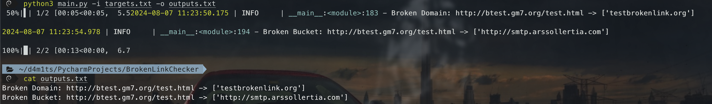

## 简介

一个用于寻找 Broken Link 和 Broken Bucket 的小脚本。


Broken Link： 如一些网站中引入了第三方的JS，而这个第三方的域名可能已经过期了没人管，这个时候我们如果去注册了这个域名，就相当于可以控制网站中的JS了。

Broken Bucket： 和上面类似，区别就在于是存储桶过期了，我们可以去接管这个存储桶达到控制JS的目的。

## 实现过程

1. 获取网页内容提取URL
2. 给URL提取成域名，并进行whois查询，确认是否注册
3. 检查提取出的URL，看是否存在存储桶接管

## 用法

```text
python3 main.py -h
usage: main.py [-h] -i INPUT [-t THREADS] [-o OUTPUT] [-j] [-v]
               [--timeout TIMEOUT] [--retries RETRIES]
               [--max-response-mb MAX_RESPONSE_MB] [--verify-tls]

输入URL列表，输出每个URL包含的链接中是否存在可以接管的Broken Link

options:
  -h, --help            show this help message and exit
  -i, --input INPUT     输入文件的路径
  -t, --threads THREADS
                        并发线程数，默认5
  -o, --output OUTPUT   输出文件的路径
  -j, --json            保存JSON格式的结果
  -v, --verbose         启用详细模式
  --timeout TIMEOUT     连接和读取超时时间，默认3秒
  --retries RETRIES     HTTP请求重试次数，默认2
  --max-response-mb MAX_RESPONSE_MB
                        单个响应最多读取的MB数，默认5
  --verify-tls          启用TLS证书校验，默认关闭以兼容原有行为
```

程序只扫描输入文件中的页面，不会递归爬取页面里发现的其他链接。

WHOIS 检查现在区分 `registered`、`unregistered`、`unknown` 和 `error`
四种状态，只有明确未注册的域名才会作为 Broken Domain 输出。


